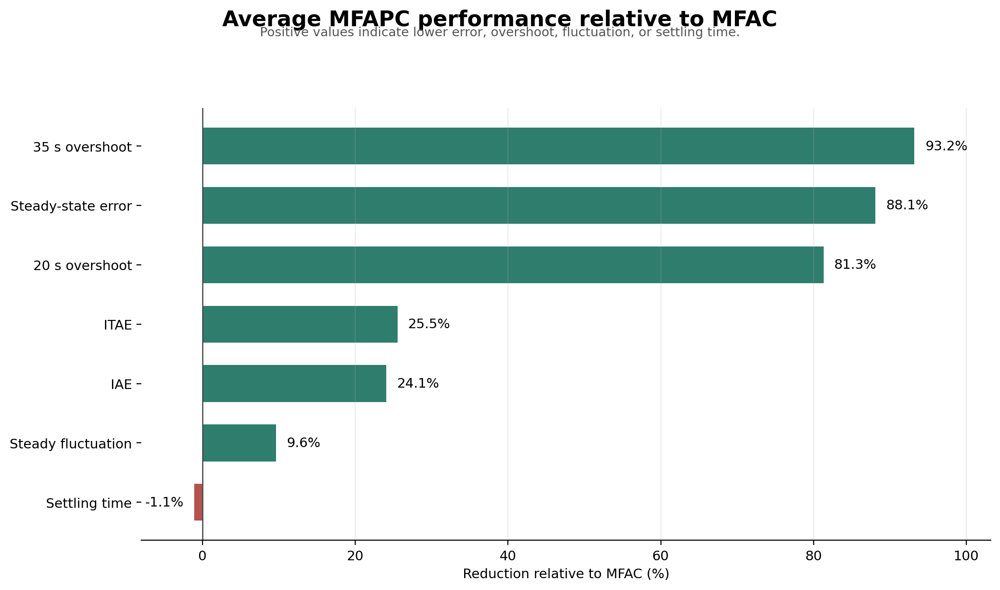
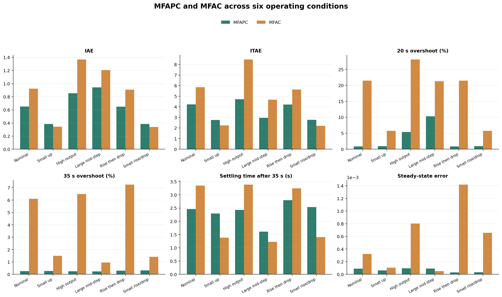
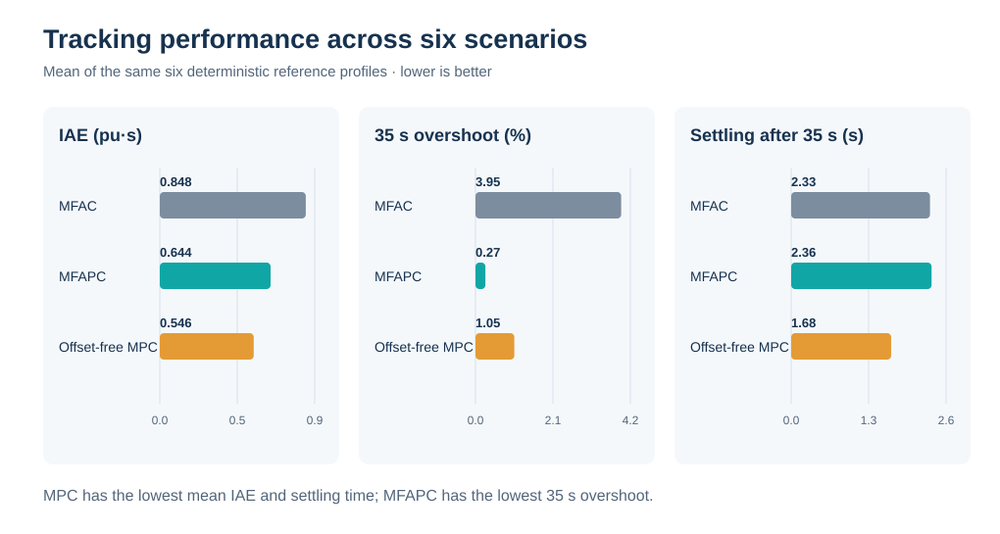
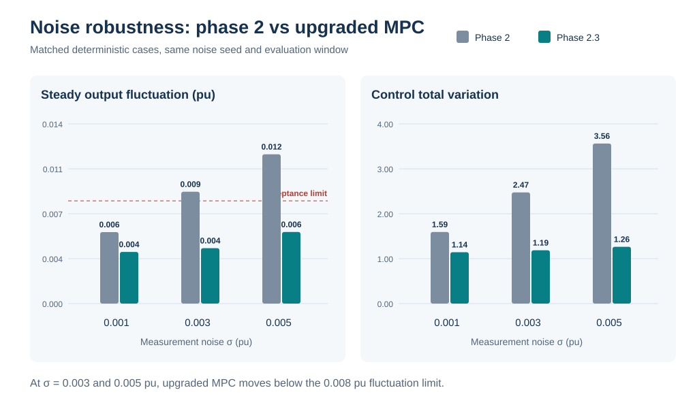

# MFAPC-Based Hydropower Generation Control

This project evaluates a model-free adaptive predictive controller (MFAPC) for active-power tracking in a Simulink hydropower generation model. It extends an earlier undergraduate simulation model with reproducible parameter sweeps, metric-based tuning, operating-condition tests, and a controlled comparison against a model-free adaptive controller (MFAC).

## Results at a glance

| Result | Evidence |
|---|---|
| MFAPC vs MFAC | 24.09% lower mean IAE and 93.20% lower mean overshoot after the 35 s step across six profiles |
| Offset-free MPC | Lowest mean IAE (0.545582) and 35 s settling time (1.678 s) among the three controllers |
| Upgraded MPC, phase 2.3 | 23/23 deterministic robustness cases passed, up from 21/23; both previously failing noise cases now pass |

These are **simulation results**, not hardware or randomized robustness guarantees. The six-profile controller comparison and 23-case MPC screen are separate experiments; their averages should not be mixed.

## MFAPC vs MFAC

Across six deterministic operating conditions, the tuned MFAPC reduced the average integral absolute error by **24.09%**, the average time-weighted absolute error by **25.54%**, and directional overshoot after the 20 s and 35 s reference changes by **81.31%** and **93.20%**, respectively, relative to MFAC.

The mean settling time was essentially unchanged: MFAPC was **1.06% slower** on average. MFAC was faster and produced lower integrated error in the two smallest-step cases, while MFAPC provided substantially better overshoot suppression and generally better steady-state accuracy.





## Final MFAPC parameters

The controller parameter vector is ordered as:

```matlab
% [lambda, rho, alpha_r, du_limit, eta, mu, alpha_d]
controller_params = [2.40, 0.32, 0.18, 0.030, 0.06, 0.08, 0.08];
```

The final values were selected through sensitivity analysis, a 36-case joint search, a 12-case local search, and a focused three-case refinement of `alpha_r`.

## Offset-free MPC

A conventional fixed-model MPC is included as a third controller. It
uses a stable second-order affine ARX prediction model identified from four
dedicated trajectories that are separate from the six benchmark conditions.
The first three trajectories are used for fitting and the fourth is held out.

Free-run validation showed that the original `0.01 s` model's excellent
one-step score did not translate directly to closed-loop prediction. The final
controller therefore uses a separately fitted `0.05 s` model, executes every
five plant samples, predicts 40 samples (`2.0 s`), and optimizes four future
input moves. The completed first-stage controller adds bounded integral target
trimming and reference filtering to remove model-mismatch offset without a
low-frequency limit cycle. Its selected settings are move weight `40`,
`|delta u| <= 0.015`, integral gain `0.03`, trim limit `0.03`, integration gate
`0.02`, and reference-filter coefficient `0.10`. A projected-gradient QP solver
avoids a run-time dependency on Model Predictive Control Toolbox.

Run the MPC workflow in MATLAB R2023a:

```matlab
run('scripts/identify_mpc_model.m')
run('scripts/analyze_mpc_model_orders.m')
run('scripts/build_mpc_model.m')
run('scripts/run_mpc_offsetfree_tuning.m')
run('scripts/run_mpc_comparison.m')
```

The generated model is named `models/HT_ctrl_MPC_baseline.slx` so it cannot
overwrite an earlier model named `HT_ctrl_MPC.slx`. See
[`docs/MPC_DESIGN.md`](docs/MPC_DESIGN.md) for the formulation and outputs.

Tuning uses three dedicated profiles that are not part of the six final test
conditions. Across those six tests, the offset-free MPC reduced its earlier
baseline mean IAE by `4.65%`, ITAE by `22.09%`, 35 s overshoot by `70.24%`,
settling time by `31.70%`, and steady-state error by `95.63%`. Its final mean
IAE is `0.545582`, mean 35 s overshoot is `1.0516%`, and mean steady-state error
is `0.000136`. MFAPC still has the lowest overshoot and steady-state error, while
the offset-free MPC provides the best overall integrated tracking error.

## Evaluation metrics

- **IAE:** integral of absolute tracking error from 20 to 50 s.
- **ITAE:** integral of time-weighted absolute tracking error from 20 to 50 s, using time measured from 20 s.
- **Directional overshoot:** overshoot for upward steps and undershoot for downward steps, expressed as a percentage of the target.
- **Settling time:** time after the 35 s reference change required to remain within a 2% target band.
- **Steady-state error:** absolute difference between the mean output from 45 to 50 s and the final target.
- **Steady-state fluctuation:** peak-to-peak output variation from 45 to 50 s.

## Operating conditions

| Scenario | Reference sequence |
|---|---|
| Nominal | 0.50 → 0.75 → 0.90 pu |
| Small upward steps | 0.50 → 0.65 → 0.75 pu |
| High output | 0.50 → 0.80 → 0.95 pu |
| Large middle step | 0.50 → 0.85 → 0.90 pu |
| Rise then drop | 0.50 → 0.75 → 0.60 pu |
| Small rise then drop | 0.50 → 0.65 → 0.55 pu |

The reference changes occur at 0, 20, and 35 s.

## Average comparison

| Metric | MFAPC | MFAC | MFAPC reduction |
|---|---:|---:|---:|
| IAE | 0.643752 | 0.848029 | 24.09% |
| ITAE | 3.608410 | 4.845817 | 25.54% |
| 20 s directional overshoot | 3.2371% | 17.3170% | 81.31% |
| 35 s directional overshoot | 0.2686% | 3.9507% | 93.20% |
| Settling time after 35 s | 2.3557 s | 2.3309 s | −1.06% |
| Steady-state error | 0.000067 | 0.000560 | 88.10% |
| Steady-state fluctuation | 0.004049 | 0.004480 | 9.62% |

### Three-controller results



The figure uses the six-scenario means in [`results/mpc_offsetfree_average_summary.csv`](results/mpc_offsetfree_average_summary.csv). Lower is better for all three shown metrics: MPC leads on tracking error and settling time, while MFAPC leads on final-step overshoot. The MPC values here are for the **frozen phase-1 offset-free controller**, not the later phase-2.3 robustness variant.

| Metric | Offset-free MPC | MFAPC | MFAC |
|---|---:|---:|---:|
| IAE | 0.545582 | 0.643752 | 0.848029 |
| ITAE | 2.784530 | 3.608410 | 4.845817 |
| 20 s directional overshoot | 3.0753% | 3.2371% | 17.3170% |
| 35 s directional overshoot | 1.0516% | 0.2686% | 3.9507% |
| Settling time after 35 s | 1.6780 s | 2.3557 s | 2.3309 s |
| Steady-state error | 0.000136 | 0.000067 | 0.000560 |
| Steady-state fluctuation | 0.004877 | 0.004049 | 0.004480 |

## Reproduction workflow

The experiments were run in MATLAB R2023a with Simulink. Required installed products included MATLAB, Simulink, Control System Toolbox, Optimization Toolbox, Simscape, and Simscape Electrical.

Recommended project structure:

```text
Hydropower_Control_Project/
├── 01_original/
├── 02_working/
├── results/
└── scripts/
```

Key experiment outputs:

```text
results/mfapc_parameter_sweep.csv
results/mfapc_joint_search.csv
results/mfapc_local_search.csv
results/mfapc_alpha_refine.csv
results/mfapc_operating_condition_results.csv
results/mfapc_vs_mfac_comparison_v4.csv
results/mpc_offsetfree_final_refinement_summary.csv
results/three_controller_offsetfree_comparison.csv
```

The final comparison uses two independent models. The MFAPC model is simulated with the tuned parameter vector, while the MFAC model is simulated separately under the same reference profiles and 50 s stop time.

## Findings and limitations

MFAPC produced lower IAE and ITAE in four of six scenarios, lower directional overshoot in all six scenarios, lower steady-state error in five scenarios, and lower steady-state fluctuation in five scenarios. Its strongest advantage was transient overshoot suppression under nominal, high-output, and rise-then-drop profiles.

The large 0.50-to-0.85 pu change still produced a 10.34% MFAPC overshoot, which identifies a practical operating boundary. MFAC was faster for the smallest reference changes. The current study is simulation-only. Deterministic phase-2 screening now covers plant-parameter uncertainty, sensor noise, load events, actuator limits, measurement delay, and operating-point changes; randomized Monte Carlo trials and hardware-in-the-loop validation remain future work. These limitations should be stated when presenting the project.

## Phase 2: robustness platform

The completed phase-1 MPC model, parameters, six-scenario results, and SHA-256
checksums are frozen in `baselines/phase1_offsetfree_mpc`. Phase-2 work uses a
separate generated model, so the published baseline cannot be overwritten.

The robustness screening platform covers plant gain and time-constant changes,
measurement noise, positive and negative load events, actuator-rate limits,
measurement delay, and low/high operating points. Run it in MATLAB R2023a:

```matlab
addpath('scripts')
build_mpc_robustness_model
run_mpc_robustness_tests("smoke")
run_mpc_robustness_tests("screening")
```

See [`docs/ROBUSTNESS_TEST_PLAN.md`](docs/ROBUSTNESS_TEST_PLAN.md) for the
23-case matrix, recorded metrics, and acceptance criteria.

The complete R2023a screening finished successfully for all 23 cases. Overall,
21 cases passed the acceptance criteria (`91.3%`). Plant-gain, time-constant,
load-disturbance, actuator-limit, measurement-delay, and operating-point cases
all achieved a 100% pass rate with zero input/move-constraint violations. The
only failures were the `0.003 pu` and `0.005 pu` measurement-noise cases, whose
steady fluctuations were `0.008711 pu` and `0.011632 pu`, above the `0.008 pu`
limit. Tracking remained bounded: the `0.005 pu` case had IAE `0.625858`, only
`5.57%` above nominal, but control total variation increased by `178.13%`.
These two failures motivated the phase-2.3 measurement-filtering upgrade below.

## Phase 2.3: upgraded MPC



At 0.003 and 0.005 pu noise, upgraded MPC reduced steady output fluctuation by **50.46%** and **52.05%**, and control total variation by **52.07%** and **64.52%**, respectively. The dashed line marks the original 0.008 pu steady-fluctuation acceptance limit. Bars come from matched case IDs in [`results/mpc_robustness_screening_results.csv`](results/mpc_robustness_screening_results.csv) and [`results/mpc_23_screening_results.csv`](results/mpc_23_screening_results.csv).

The upgraded controller adds a bounded output-disturbance estimate, adaptive
measurement filtering, quadratic soft output constraints, and integral
anti-windup. It is built as `models/HT_ctrl_MPC_23.slx` from the phase-2 test
harness; the frozen phase-1 model stays unchanged. Run in MATLAB R2023a:

```matlab
addpath('scripts')
build_mpc_23_model
run_mpc_robustness_tests("screening", "mpc23")
run_mpc_robustness_tests("stress", "mpc23")
```

The 23-case deterministic screen completed with **23/23 successful and passing
cases**, versus 21/23 for the preceding controller. At 0.003 and 0.005 pu
measurement noise, steady fluctuation fell by 50.46% and 52.05%, respectively.
The nominal IAE increased 2.31% (0.592841 to 0.606517), and the 0.005 pu
steady-error result (0.000952 pu) is close to the 0.001 pu acceptance threshold.
A separate 1.2 pu request followed by return to 0.6 pu verified recovery with
zero hard input or move violations. The 1.2 pu request exceeds the soft 1.0 pu
output bound, so its IAE is not comparable with ordinary screening runs. See
[`docs/MPC_23_UPGRADE.md`](docs/MPC_23_UPGRADE.md) for the design, tradeoffs,
reproduction steps, and full result references.

To regenerate both README charts from the committed CSVs, run `python
scripts/plot_readme_results.py` from the repository root. The plotting script
uses only the Python standard library; MATLAB is needed to rerun the simulations,
not to redraw these figures.

## Phase 2.4–2.5: Monte Carlo study and presentation

The next validation layer samples **100 joint-uncertainty cases** with a fixed
seed, combining actuator gain and time-constant changes, measurement noise,
load additions/rejections, rate limits, delays, and three operating profiles.
It reuses the R2023a phase-2.3 Simulink harness, saves a CSV/MAT checkpoint
after every case, and can resume without rerunning completed samples:

```matlab
addpath('scripts')
run_mpc_robustness_tests("montecarlo", "mpc23", 100, 2401)
build_three_controller_scorecard
plot_phase24_results(100, 2401)
```

The result summary reports mean, median, and 95th percentile for IAE, ITAE,
maximum directional overshoot, steady error, settling time, total control
variation, and constraint-violation counts, plus simulation failure and
acceptance rates. Failed runs remain in the denominator for failure/pass
rates but are not silently treated as zero-valued successful metrics. The
figures include a gain/time-constant heatmap, metric boxplots, and a logged
load-disturbance response. See [`docs/MONTE_CARLO_STUDY.md`](docs/MONTE_CARLO_STUDY.md)
for the exact ranges, statistic definitions, output paths, and interpretation
limits. The 100-case outputs and plots should be published only after the
full run finishes; a two-case pilot is not a statistical result.

The separate [three-controller scorecard](results/three_controller_scorecard.csv)
summarizes the **existing six common reference profiles**, not Monte Carlo
runs. It gives equal weight to five lower-is-better mean metrics after scaling
the best of the three controllers to 100 and the worst to 0 for each metric:

| Controller | Relative score / 100 | Mean IAE | Mean maximum directional overshoot |
|---|---:|---:|---:|
| MFAC | 0.73 | 0.8480 | 17.317% |
| MFAPC | 65.29 | 0.6438 | 3.237% |
| Offset-free MPC | 97.17 | 0.5456 | 3.075% |

This descriptive score is sensitive to its selected metrics and comparison
set; it is not a safety or statistical-significance rating. The three
controllers have not yet been run on a matched 100-case random sample.

## Resume-ready description

**Model-Free Adaptive Predictive Control for Hydropower Generation — MATLAB/Simulink**

- Reconstructed and extended a hydropower generation control model in MATLAB/Simulink, implementing a reproducible workflow for MFAPC parameter tuning and performance evaluation.
- Automated sensitivity, joint-grid, and local parameter searches using IAE, ITAE, overshoot, settling time, and steady-state metrics to select a final seven-parameter controller configuration.
- Evaluated MFAPC against MFAC across six upward and downward reference profiles; reduced mean IAE by 24.1% and directional overshoot by 81.3%–93.2%, while documenting the small-step settling-time tradeoff.
